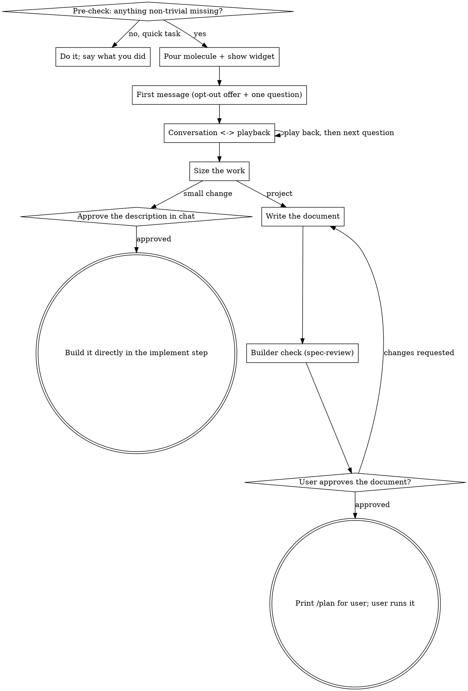

## Process Flow

**The terminal state:** a **project** hands off — after the user approves the document, print
**`Type /plan to continue`**; do NOT attempt to invoke writing-plans yourself, the user runs the
command so the skill loads via pi expansion. Do NOT invoke frontend-design, mcp-builder, or any
other implementation skill — writing-plans (via `/plan`) is the only onward step. A **small
change** does not hand off: its description is approved in chat, the document steps are resolved
or skipped, and the work is done directly in the `implement` step (close it when done).
